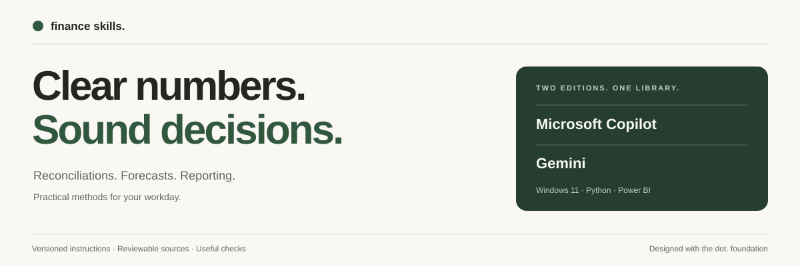

# Finance skills

[](docs/COPILOT.md) [](docs/GEMINI.md) [](LICENSE)

[Copilot setup](docs/COPILOT.md) | [Gemini setup](docs/GEMINI.md) | [All skills](SKILLS.md) | [Windows tools](docs/WINDOWS.md) | [Updates](docs/UPDATES.md) | [Support Max on Ko-fi](https://ko-fi.com/somamill)



**24 practical workflows for financial controlling, planning and reporting.** One maintained source library, separate Microsoft 365 Copilot and Gemini editions, and optional Python tools for your Windows work PC.

Start with an individual skill, supply the relevant work files in your approved account, and ask for a result with source coverage and reconciliation checks. The instructions work without a local coding agent or an API subscription. Python, Power BI, VS Code and SharePoint provide additional routes when those capabilities are available.

## Choose your edition

| | Microsoft 365 Copilot | Gemini |
| --- | --- | --- |
| Get started | [Copilot guide](docs/COPILOT.md) | [Gemini guide](docs/GEMINI.md) |
| Import packages | [Individual ZIPs](packages/copilot) | [Individual ZIPs](packages/gemini) |
| Read instructions | [Copilot SKILL.md files](editions/copilot) | [Gemini SKILL.md files](editions/gemini) |
| Work surface | Chat, Excel, PowerPoint or an eligible custom agent | Native Skills when exposed by the approved account |
| Fallback | Paste one workflow into an approved conversation | [Gem-ready instruction text](editions/gemini-gems) or a manual conversation |
| Update installed copy | Replace/edit, or update the app-created OneDrive folder and Refresh | Replace the existing skill; update Gem instructions separately |

Each ZIP contains **one root `SKILL.md`**. Upload one skill at a time. The whole repository ZIP is a transport download, not a single skill package. Package checks establish integrity; work-account import and task behavior still need verification in that account.

## Start with the work you do

| Task | Skills to begin with | Expected result |
| --- | --- | --- |
| Monthly personnel reporting | Excel data coverage, workforce reconciliation, forecast variance | Reconciled headcount/FTE and a driver explanation with exceptions |
| Actuals ingestion and mappings | Power Query ETL, account mapping, SharePoint evidence | Repeatable refresh, traceable source files and unresolved mappings retained |
| Month-end close | Close controls, spreadsheet modeling, business document | Opening-to-closing checks, an evidence register and proposed adjustments |
| Cash and planning | Cash and working capital, scenario planning | Comparable KPIs and explicit assumption-based scenarios |
| Management reporting | Power BI analysis, management presentation, corporate style | Measures and slides tied to source totals and the approved company template |
| Research and communication | Evidence research, document extraction, process diagram | Primary-source findings, extraction checks and a readable process map |

[Browse all 24 skills and their download links](SKILLS.md). The core, extended and specialist groups each contain eight skills; a custom Agent Builder agent can use a focused selection instead of the entire library.

### An example request

> Use workforce-reconciliation on the two attached monthly files. Reconcile company headcount and FTE, separate hires and leavers from transfers, show unmapped cost centres, and explain which population and checks you actually completed.

For ordinary analysis, let Excel, Power Query or a local calculation tool do the arithmetic. Use the assistant to select the method, investigate exceptions, explain the result and prepare the requested deliverable.

## Python tools that run locally

The core tools use Python's standard library. They never modify input files, make network calls or start a background service.

```powershell
py -3 scripts\finance_tools.py profile examples\actual.csv --keys cost_center account --amounts amount
py -3 scripts\finance_tools.py reconcile examples\plan.csv examples\actual.csv --keys cost_center account --amount amount
py -3 scripts\finance_tools.py bridge --plan-quantity 100 --actual-quantity 110 --plan-rate 20 --actual-rate 21 --plan-fx 150 --actual-fx 145
```

The optional `workbook_audit.py` checks stored workbook cells/formula caches with openpyxl. `duckdb_profile.py` profiles complete local CSV/Parquet files with DuckDB. Neither claims that a spreadsheet formula was recalculated or that a particular large-file capacity is guaranteed. [Windows setup and actual output definitions](docs/WINDOWS.md)

## Upstream projects, adapted to the work environment

The library draws on reviewed methods from Anthropic's document skills, DuckDB skills, scientific analysis, design review, source-based research and verification workflows. The portable finance instructions are independently authored; they do not impersonate those tools or acquire their paid APIs.

[Upstream sources and requested installation options](docs/UPSTREAMS.md) records the inspected commits, licences and host requirements for Hallmark, Anthropic skills, Claude-mem, HyperFrames, DuckDB, Valyu, D3 and the scientific skills collection. `fetch_upstreams.py` acquires pinned source archives; acquisition is separate from activating a coding-host plugin or installing a runtime on your PC.

## Keep it current

Canonical instructions live in `skills/`. A deterministic build produces both editions, 48 individual upload packages, Gem-ready text and the catalogue. Every package is tied to its source with SHA-256 hashes. Upstream changes are checked against pinned commits and reviewed before adoption. [Update workflow](docs/UPDATES.md)

```powershell
py -3 scripts\build.py
py -3 scripts\build.py --check
py -3 -m unittest discover -s tests -v
```

GitHub Actions are not enabled. A separately configured daily maintenance task checks relevant platform and upstream changes around 08:00 Asia/Tokyo; it was enabled on 2026-11-25. Compatible updates are reviewed and validated before publication. Updating GitHub does not update an existing native Copilot or Gemini import. The folder copier preserves local edits and records the package version it copied.

## Browse the catalogue

Open `site/index.html` from the extracted repository, or serve the repository locally:

```powershell
py -3 -m http.server 8000 --bind 127.0.0.1
```

Then open `http://127.0.0.1:8000/site/`. The catalogue provides edition selection, task search, example prompts and light/dark appearances. Its interface uses a pinned [dot. design foundation](branding/dot/source.json). The repository design does not replace your employer's approved reporting templates.

## Evidence and next work

[Validation record](docs/VALIDATION.md) separates tests actually run from Windows, tenant and visual checks still outstanding. [Further implementation priorities](docs/ROADMAP.md) focuses on company-specific data contracts, Power BI tie-outs and repeatable close workflows.

Keep business data, internal SharePoint addresses, credentials and private templates in approved company storage. Public examples here are synthetic. Report a reproducible issue with synthetic data and a package version.

Designed with the dot. foundation. Original library and tooling: [MIT](LICENSE). Upstream projects retain their own licences and attribution in [source notes](docs/UPSTREAMS.md).
