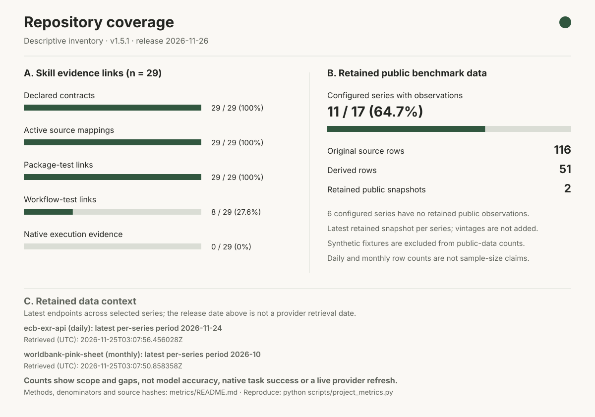

# Finance Agent Skills for Microsoft 365 Copilot and Gemini


[](docs/COPILOT.md) [](docs/GEMINI.md) [](LICENSE)

**Repeatable finance workflows for Excel reconciliation, FP&A, forecasting, financial controlling and management reporting.** One maintained library packages 29 workflows as a complete suite or individual skills for each assistant, with optional Python and Power BI tools for Windows.

[**Copilot — all workflows, one import**](https://github.com/mim1hat-prog/finance-skills/raw/refs/heads/main/releases/v1.5.1/finance-skills-v1.5.1-copilot-suite.zip) · [**Gemini — all workflows, one import**](https://github.com/mim1hat-prog/finance-skills/raw/refs/heads/main/releases/v1.5.1/finance-skills-v1.5.1-gemini-suite.zip)

Upload the complete suite ZIP unchanged. It registers **one `finance-suite` skill containing all 29 complete workflows in nine reference files**. [Single-import setup](docs/SINGLE-IMPORT.md) · [Markdown for pasting only](https://github.com/mim1hat-prog/finance-skills/raw/refs/heads/main/releases/v1.5.1/finance-skills-v1.5.1-markdown.zip) · [Full project](https://github.com/mim1hat-prog/finance-skills/raw/refs/heads/main/releases/v1.5.1/finance-skills-v1.5.1-full.zip)

[Quick start](#quick-start) · [Coverage](#coverage-at-a-glance) · [All skills](SKILLS.md) · [Downloads](#downloads) · [Copilot setup](docs/COPILOT.md) · [Gemini setup](docs/GEMINI.md) · [Help](SUPPORT.md)

## Coverage at a glance

<!-- project-coverage-summary:start -->
[](metrics/README.md)

**29 skills** · **8/29** with workflow-test links · **0/29** with native execution evidence · **11/17** configured benchmark series with observations.

Repository measurements: **v1.5.1**, release **2026-11-26**. The release date is not a provider retrieval date.

- **`ecb-exr-api` (daily):** latest retained observation period per series **2026-11-24**; retrieval timestamp (UTC) **2026-11-25T03:07:56.456028Z**.
- **`worldbank-pink-sheet` (monthly):** latest retained observation period per series **2026-10**; retrieval timestamp (UTC) **2026-11-25T03:07:50.858358Z**.

Dates describe retained snapshots. Rebuilding these graphs does not fetch providers or establish current market-data freshness.
<!-- project-coverage-summary:end -->

Generated from this branch’s canonical catalogue, research mappings, declared test links and retained public snapshots. **These measurements describe scope and gaps; they do not measure model accuracy or native task success.**

[Methods and full results](metrics/README.md) · [Machine-readable measurements](metrics/summary.json) · [Validation record](docs/VALIDATION.md) · [Proposed evaluation protocol](docs/EVALUATION.md)

## Quick start

**Upgrading after an import rejection?** v1.5.1 groups the complete procedures into nine companion files. v1.5.0 had 29, exceeding Cowork's documented 20-companion limit. [What changed and which limits apply](docs/COPILOT.md#troubleshoot-unsupported-invalid-import-limit-or-responsible-ai-errors). Native acceptance in the target account remains a separate check.

1. **Download the complete suite for [Copilot](https://github.com/mim1hat-prog/finance-skills/raw/refs/heads/main/releases/v1.5.1/finance-skills-v1.5.1-copilot-suite.zip) or [Gemini](https://github.com/mim1hat-prog/finance-skills/raw/refs/heads/main/releases/v1.5.1/finance-skills-v1.5.1-gemini-suite.zip).** Each ZIP is one native skill with all 29 workflows.
2. **Upload the complete ZIP through your host's Skills screen**, then save and explicitly select `finance-suite`. For Excel's OneDrive route, follow the [single-import folder instructions](docs/SINGLE-IMPORT.md#copilot-in-excel).
3. **Try the [invented reconciliation example](examples/QUICKSTART.md).** The two small CSVs reconcile from 350.30 to 365.35: a 15.05 difference with two unmatched records. Check that the host can read the selected workflow reference and compare the result before using a work task.

For a smaller installation, choose an [individual Copilot](packages/copilot) or [Gemini](packages/gemini) workflow. For an Instructions field, extract the [Markdown-only ZIP](https://github.com/mim1hat-prog/finance-skills/raw/refs/heads/main/releases/v1.5.1/finance-skills-v1.5.1-markdown.zip) and copy one relevant file's full text. Copy-only files have no native metadata and must not be uploaded through Skills → Add. [Import troubleshooting](docs/COPILOT.md#troubleshoot-invalid-skill-information)

The instructions use relevant internal evidence first, preserve existing workbook logic and verify calculations. They request no audit tables, extra worksheets or process commentary unless you ask for them. A local coding agent or API subscription is not required for the instruction workflow.

**Choose the correct host:** Microsoft 365 Copilot and Gemini Apps are the primary targets. GitHub Copilot and Gemini CLI are separate products. Native skills, connected sources and research features depend on your account, permissions and rollout. [Copilot guide](docs/COPILOT.md) · [Gemini guide](docs/GEMINI.md)

## Downloads

**Current package: v1.5.1.** Choose a complete suite for one native import, Markdown for pasting instructions, or the full project for local tools and documentation.

| Package | What you receive | Download |
| --- | --- | --- |
| **Copilot complete suite** | One `finance-suite` skill with 29 complete workflows in nine reference files; upload this ZIP unchanged | [Copilot suite ZIP](https://github.com/mim1hat-prog/finance-skills/raw/refs/heads/main/releases/v1.5.1/finance-skills-v1.5.1-copilot-suite.zip) |
| **Gemini complete suite** | One `finance-suite` skill with 29 complete workflows in nine reference files; upload this ZIP unchanged | [Gemini suite ZIP](https://github.com/mim1hat-prog/finance-skills/raw/refs/heads/main/releases/v1.5.1/finance-skills-v1.5.1-gemini-suite.zip) |
| **Markdown only** | 60 `.md` files: 29 Copilot skills, 29 Gemini skills, Excel agent instructions and a start guide | [Markdown ZIP](https://github.com/mim1hat-prog/finance-skills/raw/refs/heads/main/releases/v1.5.1/finance-skills-v1.5.1-markdown.zip) |
| **Copilot** | 29 individual skill ZIPs, matching folders and Excel agent instructions | [Copilot ZIP](https://github.com/mim1hat-prog/finance-skills/raw/refs/heads/main/releases/v1.5.1/finance-skills-v1.5.1-copilot.zip) |
| **Gemini** | 29 individual skill ZIPs, matching folders, Gem-ready text and Excel agent instructions | [Gemini ZIP](https://github.com/mim1hat-prog/finance-skills/raw/refs/heads/main/releases/v1.5.1/finance-skills-v1.5.1-gemini.zip) |
| **All skills** | Both editions, 58 individual ZIPs, folders, Gem-ready text and Excel agent instructions | [All-skills ZIP](https://github.com/mim1hat-prog/finance-skills/raw/refs/heads/main/releases/v1.5.1/finance-skills-v1.5.1-all.zip) |
| **Full release** | All skills plus project sources, guides, public benchmark components, Python tools, tests and the visual catalogue | [Full ZIP](https://github.com/mim1hat-prog/finance-skills/raw/refs/heads/main/releases/v1.5.1/finance-skills-v1.5.1-full.zip) |

For Markdown, open the relevant file in VS Code or Notepad and copy all its contents. Each file contains its complete edition-specific instructions without YAML headers; the archive contains no scripts, datasets or nested ZIPs. **Do not upload these files through Skills → Add.** Renaming a copy-only file to `SKILL.md` does not restore its required metadata.

For the **complete suite ZIPs**, upload the file itself: one root `SKILL.md` routes to bundled workflow references. For the **Copilot/Gemini individual-package bundles, all-skills bundle and full project**, extract the outer ZIP first and select a native package. The suite appears as one installed skill; it does not create 29 separate entries or enable unavailable tools. [Package formats and replacement](docs/SINGLE-IMPORT.md)

[Release notes and SHA-256 checksums](https://github.com/mim1hat-prog/finance-skills/blob/main/releases/v1.5.1/README.md) · [All releases](releases/README.md) · [Versioning and verification](docs/RELEASES.md)

## Find a workflow

| Your task | Start here | Expected result |
| --- | --- | --- |
| Monthly personnel reporting | Excel data coverage, workforce reconciliation, forecast variance | Headcount/FTE reconciliation and an explanation of verified drivers and exceptions |
| Actuals and mappings | Power Query ETL, account mapping, SharePoint evidence | Traceable sources, repeatable refresh and unresolved mappings retained |
| Month-end close | Close controls, spreadsheet modeling, business document | Opening-to-closing checks, material exceptions and proposed adjustments |
| Cash and planning | Cash and working capital, scenario planning | Comparable KPIs and explicit assumption-based scenarios |
| Management reporting | Power BI analysis, management presentation, corporate style | Measures and slides tied to source totals and the approved template |
| Research and communication | Evidence research, document extraction, process diagram | Primary-source findings, checked extraction and readable process maps |

[**Browse all 29 skills**](SKILLS.md) · [Exact inputs, outputs and acceptance criteria](docs/SKILL-CONTRACTS.md) · [Tool list and availability](TOOLS.md)

> Use workforce-reconciliation on the two attached monthly files. Reconcile company headcount and FTE, separate hires and leavers from transfers, show unmapped cost centres, and explain which population and checks you completed.

Let Excel, Power Query or a local calculation tool do the arithmetic. Use the assistant to select the method, investigate exceptions, explain the result and prepare the requested deliverable.

### Save your Excel agent defaults

[**Download ready-to-paste Excel agent instructions**](https://github.com/mim1hat-prog/finance-skills/raw/refs/heads/main/profiles/excel-agent-instructions.txt) and paste them into the **Instructions** field you already use. Compare and preserve approved company additions before saving.

The profile prioritizes relevant available internal sources, retries incomplete retrieval, preserves workbook logic, verifies the result and keeps the response concise. It is generated from the same [canonical source](skills/excel-agent-core/SKILL.md) as the individual [Copilot](packages/copilot/excel-agent-core.zip?raw=1) and [Gemini](packages/gemini/excel-agent-core.zip?raw=1) skills. Importing it as a skill does not guarantee that it becomes the default for every request.

## Choose your assistant

| | Microsoft 365 Copilot | Gemini |
| --- | --- | --- |
| Setup | [Copilot guide](docs/COPILOT.md) | [Gemini guide](docs/GEMINI.md) |
| Native packages | [Individual ZIPs](packages/copilot) | [Individual ZIPs](packages/gemini) |
| Read instructions | [Copilot skill folders](editions/copilot) | [Gemini skill folders](editions/gemini) |
| Work surface | Chat, Excel, PowerPoint or an eligible custom agent | Native Skills when exposed by the approved account |
| Fallback | Paste one workflow into an approved conversation | [Gem-ready text](editions/gemini-gems) or an approved conversation |
| Update an installed copy | Replace/edit, or update the app-created OneDrive folder and Refresh | Replace the skill; update Gem instructions separately |

Use a focused selection for a custom agent and respect its available skill slots. Package checks establish integrity; import and task behavior require verification in the target account. Copilot Researcher and Gemini Deep Research have their own availability and limits. The [research policy](docs/RESEARCH-POLICY.md) calls for targeted retrieval, independent checks and concise conclusions; it cannot increase quotas or grant access. Native Gemini Skills currently do not run inside Deep Research.

## Evidence, standards and public data

Every workflow keeps **approved internal figures**, **internal workflow status** and **public benchmarks** separate. Match periods, cutoffs, scenarios, versions, units and snapshots before comparing. Public data never fills a missing internal forecast, exposure, mapping or confirmation. A successful calculation does not prove refresh, approval or submission.

The full release contains **119 ECB FX observations**—68 published rates and 51 separately derived JPY crosses—and **48 World Bank commodity observations** for aluminum, copper, Brent and Japan LNG. Two retained public snapshots record periods, retrieval timestamps, units, source IDs, rights and transformations. Synthetic vintage fixtures are separate.

The local read-only API serves validated snapshots through four routes. Use an immutable `snapshot_id`, or `as_of` only when a snapshot was retained by that cutoff. An earlier observation period does not establish what was known at an earlier forecast date. Failed refreshes preserve the last good snapshot.

**Source status:** ECB and the selected World Bank extracts were exercised. BOJ values are excluded pending reproduction permission. METI transport-production and MHLW wage/hour configurations remain candidates pending exact source validation.

[Dataset and API guide](benchmarks/README.md) · [Data dictionary](benchmarks/DATA_DICTIONARY.md) · [OpenAPI contract](api/openapi.yaml) · [Research registry](research/README.md) · [Workflow pilots](docs/WORKFLOWS.md)

The registry links each integrated source to the method, skill, decision or test it supports. [Standards](docs/STANDARDS.md) documents Agent Skills, SemVer, CFF, SPDX, JSON Schema, OpenAPI and RFC 9457, with lightweight provenance informed by W3C and FAIR. No certification or peer-reviewed status is claimed.

## Optional local tools

The finance calculation and workflow helpers use Python's standard library, leave inputs unchanged and make no network calls. The separate public benchmark collector runs only through an explicit refresh command; the API starts manually in the foreground.

```powershell
py -3 scripts\finance_tools.py profile examples\actual.csv --keys cost_center account --amounts amount
py -3 scripts\finance_tools.py reconcile examples\plan.csv examples\actual.csv --keys cost_center account --amount amount
py -3 scripts\finance_tools.py bridge --plan-quantity 100 --actual-quantity 110 --plan-rate 20 --actual-rate 21 --plan-fx 150 --actual-fx 145
```

Optional helpers use openpyxl for stored workbook cells and formula caches, and DuckDB for local CSV/Parquet profiling. They do not establish spreadsheet recalculation or guarantee a large-file capacity. [Windows setup and output definitions](docs/WINDOWS.md)

### Visual catalogue

Open `site/index.html` from the extracted full release, or serve the repository locally:

```powershell
py -3 -m http.server 8000 --bind 127.0.0.1
```

Open `http://127.0.0.1:8000/site/` for edition selection, task search, prompt copying and theme controls. Skill descriptions, prompts and Copilot download links remain readable without JavaScript. This included catalogue is not a claimed public website deployment.

## Maintain and contribute

Canonical instructions live in `skills/`. The deterministic build generates both editions, native packages, Gem-ready text, the Excel profile, Markdown downloads, coverage statistics and catalogue. Releases freeze the downloads with checksums and preserve prior versions.

```powershell
py -3 scripts\research_registry.py
py -3 scripts\build.py
py -3 scripts\check_release.py
```

The offline gate checks generated files, workflow/tool/source references, dataset and API contracts, tests and package contents. Git identity is reviewed separately. [Maintenance and installed-copy updates](docs/UPDATES.md) · [Release procedure](docs/RELEASES.md)

A separately configured weekly maintenance task checks relevant platform and upstream changes on Wednesdays at 08:00 Asia/Tokyo. The weekly schedule was confirmed on 2026-11-25. Compatible updates require validation and resolved publication-identity checks. This repository includes no GitHub Actions workflows. Updating GitHub does not update skills already imported into Copilot or Gemini.

| Read or contribute | Where to go |
| --- | --- |
| Setup help or a reproducible bug | [Support](SUPPORT.md) |
| Propose a skill or improve a workflow | [Contributing](CONTRIBUTING.md) · [Code of conduct](CODE_OF_CONDUCT.md) |
| Inspect completed checks and remaining work | [Validation](docs/VALIDATION.md) · [Roadmap](docs/ROADMAP.md) |
| Review the methods and design decisions | [Research registry](research/README.md) · [Discovery design](docs/DISCOVERY.md) |
| Cite a specific version | [CITATION.cff](CITATION.cff) |

Keep business data, internal links, credentials and private templates in approved company storage. Examples and test cases are independently invented; public observations retain their own attribution and rights. [Security and data boundaries](SECURITY.md)

The portable finance instructions are independently authored. [Upstream notes](docs/UPSTREAMS.md) record reviewed commits, licences and host requirements for the source projects; acquiring their archives does not activate their plugins or install a runtime on your PC.

---

Designed with the pinned [dot. foundation](branding/dot/source.json). Use your employer's approved templates for work outputs. Original library and tooling: [MIT](LICENSE); upstream projects and data retain their own licences and attribution.
