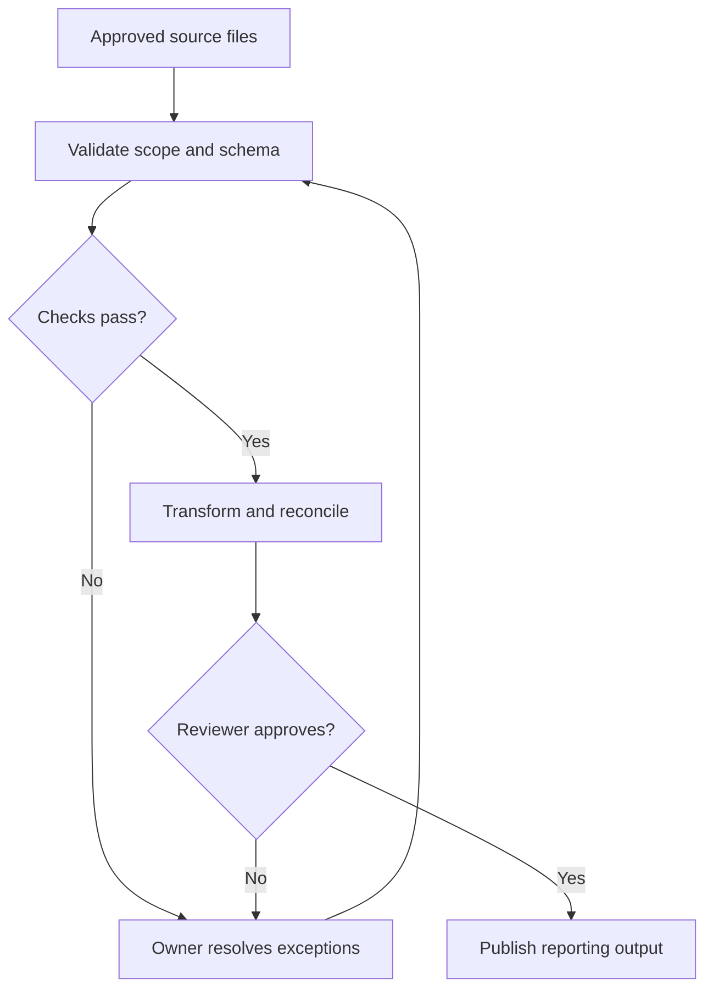

# Finance process and data-flow diagrams

## Gemini edition

Default output: Give the requested result directly with concise source references, necessary calculations, recommendations, and material unresolved exceptions. Keep routine verification internal. Do not create audit tables, audit logs, audit text, new worksheets, or unrelated reports unless specifically requested; a requested data table, model, or report remains allowed. Preserve existing business logic and avoid filler, AI/process commentary, and unnecessary summaries or tables.

Use this skill in the employer-approved Gemini account. Work with the attached files and capabilities actually exposed in this conversation. Do not assume a SharePoint connector, a live Power BI model, direct Office editing, Gemini CLI, or access to the user's Windows filesystem. Keep company content in approved accounts and locations.

Use available file and calculation tools for complete accessible inputs. Skill scripts must not depend on internet access, authenticated APIs, or package installation. Keep SQL in Markdown code blocks. An optional Python workflow runs separately on the work PC unless an available Gemini calculation tool actually executes it. Treat all proposed scripts, queries and output files as unexecuted until there is observable evidence; request the resulting control totals or artifact for follow-up analysis.

Do not promise that a skill can run with Canvas or Deep Research. If one of those separate tools is needed, provide an explicit task brief and source requirements for that workflow, then work from the result the user returns. Use primary citations only from sources actually accessed.

Use native Skills if the work account exposes Customize > Skills. Google documentation currently differs on work-account rollout, so check the account rather than infer availability. If Skills is absent but Gems is available, place the workflow in the Gem's Instructions; a knowledge attachment alone does not make it an instruction. Otherwise paste the task instructions into an approved conversation. Imported skills and Gem instructions do not automatically track GitHub; replace the existing copy after an update.

## Shared workflow controls

Use all relevant available, authorized capabilities needed for the objective. For company questions, retrieve enterprise evidence first. Before treating a missing search result as missing data, inspect the source content and try a materially different query, period, linked reference or responsible-source route. Continue while another available step can resolve a material uncertainty; do not repeat unchanged searches or browse unrelated sources to inflate coverage. Use an available deeper research/reasoning mode when appropriate and supported; instructions cannot select a hidden mode, grant permissions or exceed platform limits.

Independently recheck consequential results with a second calculation, source record or alternative method. Rereading the same answer is not an independent check. Investigate contradictions and failed checks, correct them, then rerun the affected checks. Finish when the requested scope is complete and material claims are supported, or report the specific unresolved gap after useful retrieval routes are exhausted. At a host limit, preserve the objective, source locators, versions, decisions and pending work in a compact continuation; never claim that unseen work was completed. Keep this diligence internal and the final response precise.

Keep three streams distinct: approved internal figures; internal workflow status; public benchmarks. An internal blank stays unresolved until the authorized source supplies it. A benchmark can challenge an assumption but cannot become an actual, approved forecast, booked rate, mapping, case confirmation or close receipt.

Before comparing numbers, align period and cutoff/timezone, scenario and version, entities, accounting/reporting basis, currency/unit, sign convention and source snapshot. Keep a requested frozen submission separate from newer working files. Record exact source locations and what each source establishes in working context; do not create an audit artifact merely to store these checks.

Validate business keys, join cardinality, effective dates, gross movements and detailed coordinates as well as totals. Normalize units/signs only from explicit declarations. Calculate residuals at source precision and use an approved, versioned, effective tolerance. An unexplained residual is not rounding by default.

Preserve the baseline workbook/query, protected records, ordered names/types, formulas, load targets, add-in regions and downstream consumers outside the requested change. Successful refresh alone does not establish population or interface parity. Return complete replacement code only for the affected existing scope when code is requested.

Keep evidence state separate from action state: found, calculated, refreshed, uploaded, reconciled, approved and submitted require different evidence. Default to inspection/preparation. For an authorized write, reuse authorization that covers the exact target and payload, check preconditions and verify independently. If the outcome is uncertain or a write times out, read back before retrying; do not substitute locked or unapproved objects. Local validation helpers execute no enterprise writes.

Return the useful answer concisely: approved result, verified internal driver, relevant public benchmark, then material residual/blocker and next source. State only the statuses supported by evidence. Keep diagnostic detail in working context; do not add unsolicited sheets, audit tables, comments, queries, logs or process narration.

Turn supplied process evidence into a clear view of inputs, actions, decisions, outputs, owners and exceptions. Use a diagram only when branching, handoffs, lineage or sequence adds understanding. For a simple list or one-step relationship, use concise prose. Mermaid source is a valid diagram deliverable when rendering is unavailable; an additional ownership/control table is optional and requires a request.

## Establish what the diagram represents

Confirm the audience, question, scope boundary and whether the request concerns the current process, a proposed process or a comparison. Identify trigger, start/end conditions, source systems/files, destinations, owner roles, review points, cadence and failure paths from supplied evidence. Ask only about gaps that change the topology; label other gaps as unknown or proposed.

Do not assume a named system is integrated, refreshed automatically or accessible to an assistant. A proposed automation must remain visibly proposed until implementation evidence exists. Keep internal system names, tenant URLs and employee identities in approved work outputs; use generic role/system labels in public examples.

## Build the process model

1. **Inventory objects.** Separate source data, transformations, controls, decisions and output artifacts. Name the data exchanged at important handoffs, such as “approved mapping”, “exception table” or “published forecast”. An arrow should express a clear movement or dependency.
2. **Map ownership.** Give each activity an accountable owner role and identify a separate reviewer where the process provides one. Mark unspecified roles as unassigned rather than inventing approval authority. A diagrammed approval does not prove that approval occurred.
3. **Identify checks.** Show where scope/completeness, mapping, reconciliation or review must pass. Put a necessary long decision rule in a concise note beside the diagram. Show what happens on failure: return for correction, hold, escalate or stop, based on the actual process. Do not create a separate control table by default.
4. **Distinguish data and control.** A report can read a file without granting write access. A handoff can be manual even when both applications are cloud services. Identify manual uploads, local Python steps and approved connector calls accurately. Do not imply bidirectional synchronization from a one-way import.
5. **Check the path.** Trace a normal case and at least one exception from start to finish. Look for missing owners, impossible ordering, dead ends, duplicate control steps and loops with no exit rule. Make open questions visible outside the diagram.

## Draw with portable Mermaid

Use a flowchart for process steps and branches, a sequence diagram for timed handoffs, or an entity-relationship diagram for table relationships. Prefer one relationship per diagram. Split a large workflow into an overview and focused sections; aim for 6–12 meaningful nodes per flowchart, and never place more than five nodes or participants horizontally. Use top-to-bottom flow when the path is long.

Use simple node IDs, short sentence-case labels and quotes around labels containing punctuation. Avoid HTML, click directives, remote images, custom JavaScript and per-diagram configuration. Keep color optional and never the sole indicator of status or responsibility. Put the legend, source notes and detailed control criteria in ordinary text. Use supported basic syntax from the [official Mermaid flowchart reference](https://mermaid.js.org/syntax/flowchart.html).

A compact generic control flow can look like this; change it to match evidence rather than treating it as the user's actual architecture:

## Add the operating detail

Include only the operating detail needed to understand the requested diagram, with labels consistent across the diagram and concise notes. If the user requests an ownership/control table, include step ID, activity, input, output/evidence, owner role, reviewer/control, timing and failure action. For a requested data-lineage description, identify source/destination grain and refresh responsibility where known. Do not add an audit table or full operating report merely because a diagram was requested.

For a current/proposed comparison, use two compact diagrams or one clearly labeled change table. Distinguish observed steps from assumptions and recommendations. Describe what each change improves and which access, dependency or ownership decision is still needed. Do not assign savings, cycle-time reduction or error-rate improvement without measurements or an explicit estimate basis.

## Verify and deliver

Check that every diagram node has a defined purpose, every decision has labeled outcomes, every exception path reaches an owner/action, and each important output has a destination. Verify the model against the supplied process evidence. If a renderer is available, inspect clipping, legibility and edge labels at the intended size. If it is not, state that the source was checked but not rendered; do not invent visual QA.

Return the requested diagram/source with concise source references and material unresolved questions. Add a brief explanation only where needed to understand the path or an unrendered diagram. Include an ownership/control table or separate report only when requested. Use the user's approved company template for a requested presentation export; repository branding does not establish the employer's brand.

Example request: “Diagram the monthly forecast process from SharePoint uploads through Power Query validation into Power BI. Show who resolves schema and reconciliation errors, where review happens, and which steps are currently manual.”

## Edition record

Finance skills 1.3.0; gemini edition; source review 2026-11-25. This date records the package review, not the freshness of a user's business data.
