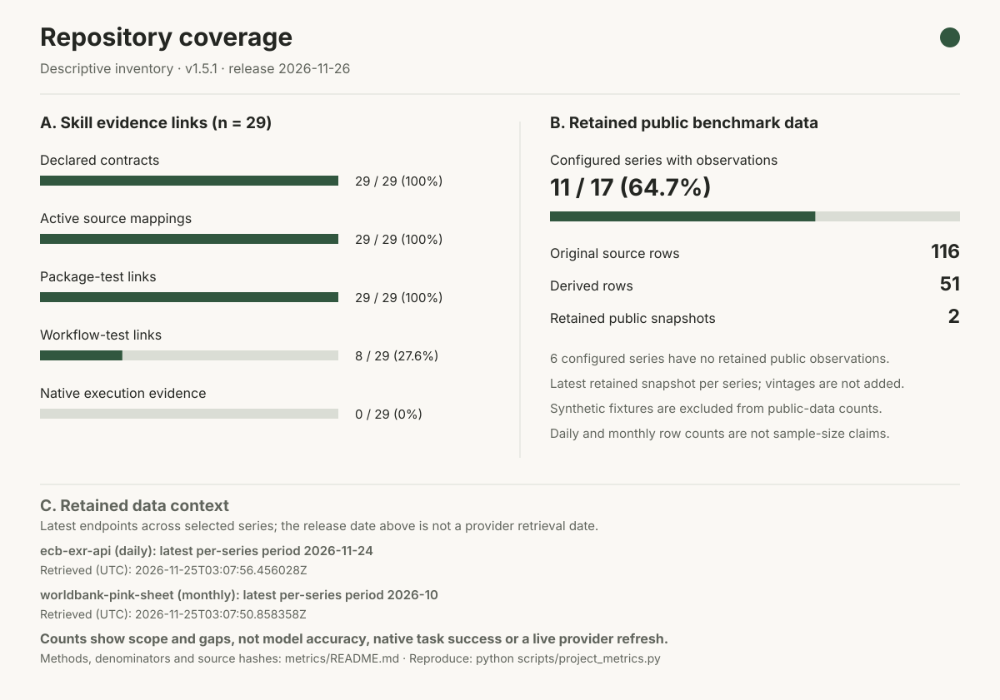

# Repository coverage and public-data inventory

Version **1.4.0** · release date **2026-11-25** · generated offline from the committed sources.

These descriptive counts make implemented scope and remaining gaps visible. They do not measure model accuracy, task success or effectiveness in a work account.



[Machine-readable measurements](summary.json) · [Generator](../scripts/project_metrics.py) · [Validation record](../docs/VALIDATION.md)

## Skill coverage

The denominator is the complete canonical skill catalogue, including the Excel agent defaults. A test link means the named test exists; it does not mean a model completed that workflow.

| Measurement | Numerator / denominator | Definition |
| --- | --- | --- |
| Declared workflow contracts | 29 / 29 (100%) | Skills with structured inputs, outputs and execution conditions |
| Active source mappings | 29 / 29 (100%) | Skills linked to an active registry source with a matching stated use |
| Declared package-test links | 29 / 29 (100%) | Skills naming at least one resolvable local package test |
| Declared workflow-test links | 8 / 29 (27.6%) | Skills naming at least one resolvable local workflow test; full task coverage is not implied |
| Native execution evidence | 0 / 29 (0%) | Skills with an accepted native-account validation record; currently none is supported by the public contract |

### Scope by task category

Categories are the project's editorial grouping, not an external financial taxonomy or a completeness score.

| Category | Skills |
| --- | ---: |
| Agent setup | 1 |
| Analysis | 4 |
| Controls | 5 |
| Core | 2 |
| Design | 2 |
| Pipeline | 2 |
| Planning | 5 |
| Reporting | 5 |
| Research | 3 |

### Explicit gaps

Skills without a declared workflow-test link: `analytical-sql`, `business-document`, `cash-working-capital`, `close-controls`, `corporate-style`, `design-review`, `document-extraction`, `evidence-research`, `excel-data-coverage`, `forecast-variance`, `interactive-visualization`, `management-presentation`, `power-bi-analysis`, `process-diagram`, `project-context`, `reproducible-analysis`, `scenario-planning`, `sharepoint-evidence`, `spreadsheet-modeling`, `video-storyboard`, `work-tool-routing`.

All host workflows still require a representative check in the actual approved Copilot/Gemini account. Local package and helper checks cannot establish host activation, tool access or answer quality.

## Research and tool inventory

The registry has **75 records: 74 active and 1 candidate**. Candidates are excluded from active skill support. Active records can be standards, provider documentation, software references or project design decisions; this total is not a count of peer-reviewed experiments.

| Source review status | Records |
| --- | ---: |
| carried-forward | 16 |
| needs-review | 1 |
| reviewed | 30 |
| reviewed-with-limitations | 28 |

The tool catalogue contains **29 capabilities/products**. Availability labels remain separate from installation or integration evidence.

| Tool availability label | Entries |
| --- | ---: |
| capability-only | 7 |
| confirm-at-work | 9 |
| local-implementation | 1 |
| optional-evaluation | 5 |
| partial-user-reported | 2 |
| user-reported | 5 |

[Exact source uses and limitations](../research/README.md) · [Tool availability definitions](../TOOLS.md)

## Retained public benchmark data

**11 / 17 (64.7%) configured series** have observations in their latest retained public snapshot. Across those selected series there are **116 original rows** and **51 separately derived rows**. The store retains **2 public snapshots**. Synthetic fixtures do not contribute to these totals.

Each series is counted from its own latest retained public snapshot. Repeated historical rows in later vintages do not inflate the total. The table reports row availability and stored period ranges, not completeness against an official trading/release calendar.

| Series | Kind | Rows | Stored periods | Unit |
| --- | --- | ---: | --- | --- |
| `ecb-cny-per-eur` | original | 17 | 2026-11-02 to 2026-11-24 | CNY per EUR |
| `ecb-jpy-per-eur` | original | 17 | 2026-11-02 to 2026-11-24 | JPY per EUR |
| `ecb-thb-per-eur` | original | 17 | 2026-11-02 to 2026-11-24 | THB per EUR |
| `ecb-usd-per-eur` | original | 17 | 2026-11-02 to 2026-11-24 | USD per EUR |
| `project-jpy-per-cny` | derived | 17 | 2026-11-02 to 2026-11-24 | JPY per CNY |
| `project-jpy-per-thb` | derived | 17 | 2026-11-02 to 2026-11-24 | JPY per THB |
| `project-jpy-per-usd` | derived | 17 | 2026-11-02 to 2026-11-24 | JPY per USD |
| `worldbank-aluminum` | original | 12 | 2025-11 to 2026-10 | USD per metric tonne |
| `worldbank-brent` | original | 12 | 2025-11 to 2026-10 | USD per barrel |
| `worldbank-copper` | original | 12 | 2025-11 to 2026-10 | USD per metric tonne |
| `worldbank-japan-lng` | original | 12 | 2025-11 to 2026-10 | USD per million Btu |

### Configured series without retained observations

These remain visible in the denominator. A configured adapter or public URL is not a supported observation feed.

| Series | Adapter state | Redistribution |
| --- | --- | --- |
| `boj-domestic-producer-price` | rights-gated | permission-required |
| `boj-import-price-jpy` | rights-gated | permission-required |
| `meti-transport-production-original` | needs-source-validation | permitted |
| `meti-transport-production-sa` | needs-source-validation | permitted |
| `mhlw-hours-candidate` | requires-configuration | unverified |
| `mhlw-wages-candidate` | requires-configuration | unverified |

### Retained acquisition evidence

| Public snapshot | Retrieval timestamp | Rows in that vintage |
| --- | --- | ---: |
| [20261125t030750z-e3debcf7d3272b67](../benchmarks/snapshots/20261125t030750z-e3debcf7d3272b67/snapshot.json) | 2026-11-25T03:07:50.858358+00:00 | 48 |
| [20261125t030756z-642357aa97b8b3af](../benchmarks/snapshots/20261125t030756z-642357aa97b8b3af/snapshot.json) | 2026-11-25T03:07:56.456028+00:00 | 119 |

Snapshot rows are shown separately for retention evidence; do not sum overlapping vintages as additional observations. A retrieval timestamp establishes the stored acquisition, not a claim that the provider has been checked again today. See [dataset methods and rights](../benchmarks/README.md) and the [data dictionary](../benchmarks/DATA_DICTIONARY.md).

## Reproduce the measurements

```powershell
py -3 scripts\project_metrics.py
py -3 scripts\project_metrics.py --check
```

The generator validates workflow/tool references, source-to-skill mappings and the public dataset inventory before counting. It reads `catalog.json`, `tools/catalog.json`, `research/sources.json`, `benchmarks/catalog.json` and the validated public snapshot files. The JSON output records their SHA-256 hashes. It performs no network calls, does not execute tests and does not inspect private workbooks or work accounts.

For every ratio, percentage = numerator ÷ denominator × 100, rounded to one decimal place. An empty denominator is undefined. The SVG is generated from the same summary as this page, with labeled counts and denominators. No confidence interval or significance test is appropriate for this complete, deterministic repository inventory.

### Interpretation limits

- These are descriptive counts, not model accuracy, task success, statistical confidence or native account validation.
- A linked local test is a declared test reference, not a full-workflow pass or an execution receipt; this generator does not run tests.
- Repository skill categories are editorial classifications, not a representative sample of all finance tasks.
- Observed-series coverage is availability within this project's configured catalogue, not coverage of all public finance data or of a company's inputs.
- Daily and monthly observations count retained rows; they are not comparable sample sizes. Financial values with different units are never pooled.
- Stored retrieval timestamps and observation periods are not a live refresh, freshness guarantee or evidence of what was known before those snapshots were captured.
